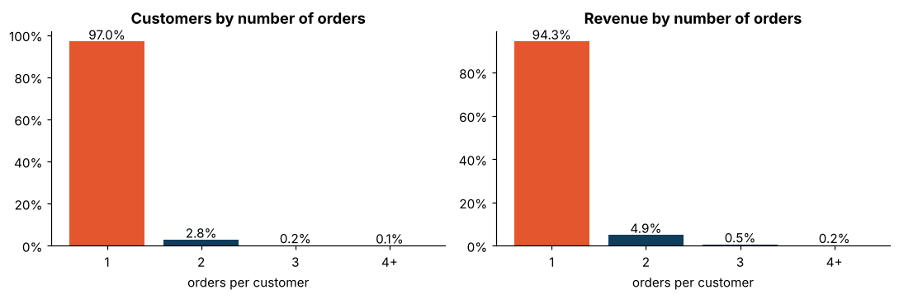
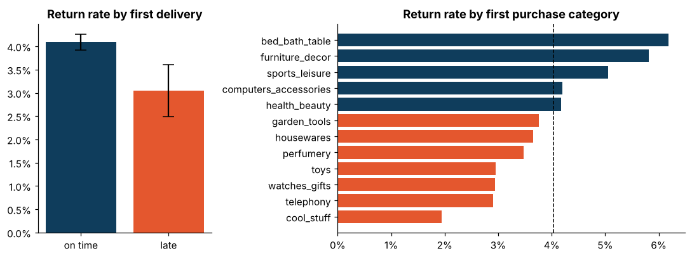
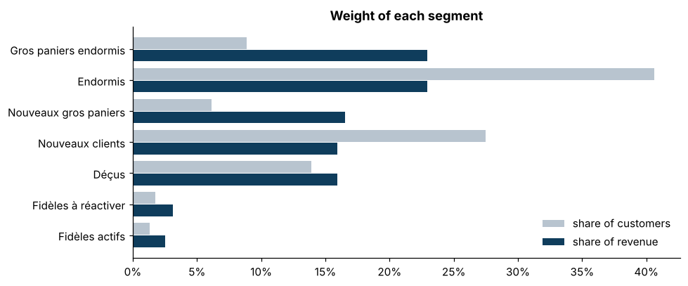

# Customer segmentation: a retention problem, not an acquisition problem


**[Interactive dashboard](https://mohfofana.github.io/projets/segmentation-clients/)** ·
**[Full analysis notebook](notebooks/01_customer_segmentation.ipynb)**

Segmentation of **94,989 customers** of the Olist marketplace (Brazil, 2016-2018) and analysis
of what makes a first-time buyer come back. Data comes from the `mart_customer_rfm` and
`fct_orders` tables of my [ecommerce-data-pipeline](https://github.com/mohfofana/ecommerce-data-pipeline).

## Key findings

- **97 %** of customers ordered only once; repeat customers bring **under 6 %** of revenue.
  A textbook RFM grid is useless here: the business question is the **second order**.
- A **late first delivery cuts the return rate by 25 %** (3.05 % vs 4.09 %, two-proportion
  z-test, p = 0.002). This connects the logistics analysis of
  [delivery-delay-prediction](https://github.com/mohfofana/delivery-delay-prediction) to revenue.
- The **first purchase category** is the strongest driver: bed & bath and furniture customers come
  back **3.2x** more often than "cool stuff" (gadgets) customers.
- A third of second orders happen within one day, half within a month, two thirds within 90 days:
  **the window to act is short**.




## Segments

Business rules (`src/segmentation/segments.py`) built on recency, value, repeat behaviour and
satisfaction, the levers a CRM team can act on:

| Segment | Rule | Customers | Revenue |
|---|---|---|---|
| Fidèles actifs | 2+ orders, recent | 1.3 % | 2.5 % |
| Fidèles à réactiver | 2+ orders, not recent | 1.7 % | 3.1 % |
| Déçus | one order, review 1-2 | 13.9 % | 15.9 % |
| Nouveaux gros paniers | one recent order, top 20 % basket | 6.1 % | 16.5 % |
| Nouveaux clients | one recent order | 27.5 % | 15.9 % |
| Gros paniers endormis | one old order, top 20 % basket | 8.9 % | 23.0 % |
| Endormis | one old order, standard basket | 40.6 % | 23.0 % |



**Validation with K-means** (`src/segmentation/clustering.py`): on standardized recency, value,
frequency, review and late-delivery rate, k = 5 rediscovers the same axes: repeaters, two
groups of unhappy one-time buyers (one where every order was late, one unhappy without delay),
and satisfied one-time buyers split by recency. The rules are kept for operations because a CRM
team can explain and maintain them; clustering shows they are not arbitrary.

## Recommendations

1. **Protect the first delivery**: prioritize first-time customers in the late-delivery risk flag.
2. **Recover "Déçus"** within days of a 1-2 star review, with an apology and a voucher on the next order.
3. **30-day journey for "Nouveaux gros paniers"**: cross-sell around their first category.
4. **Measure with A/B tests**: +1 point of return rate is about 100 more returning customers per
   10,000 new ones, around R$ 14,700 of second-order revenue (average second order R$ 147).

## Project structure

```
├── src/segmentation/
│   ├── data.py         load marts, build the first-order table with an observation window
│   ├── segments.py     business segments
│   ├── clustering.py   K-means validation (k selection by silhouette)
│   └── retention.py    return-rate drivers, two-proportion z-test
├── notebooks/01_customer_segmentation.ipynb
├── dashboard/build_dashboard.py           interactive dashboard (Plotly)
├── reports/figures/
└── tests/
```

## Run it

```bash
pip install -r requirements.txt
pytest
python dashboard/build_dashboard.py
jupyter notebook notebooks/01_customer_segmentation.ipynb
```

## Method notes

- **Observation window**: return rates use customers whose first order is before March 2018, so
  everyone had at least six months to come back. Otherwise recent customers would look like
  churners only because the data stops.
- **Recency** is measured against the last date of the dataset, not today.

Data: *Brazilian E-Commerce Public Dataset by Olist* (Kaggle, CC BY-NC-SA 4.0). Code: MIT.
